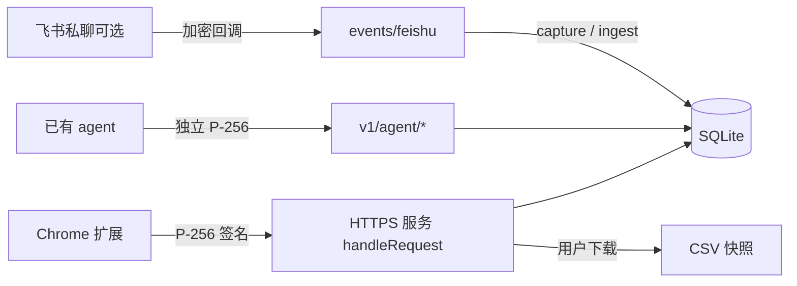

# 架构与接口

**服务端 SQLite 是唯一主库。** Chrome 与可选飞书私信收录共用同一数据库；不提供多维表格同步。分析由用户已有的对话型 agent 完成，ReadFlow 不调用模型 API、不存模型密钥。配对／API key 通道的产品改版尚未开始，本文描述**当前已实现**结构。



## 运行时边界

| 角色 | 鉴权 | 能力 |
| --- | --- | --- |
| Chrome | 浏览器配对公钥 + `X-ReadFlow-*` 签名；`provider` 固定为 `database` | 收藏、同步、阅读状态、删除、偏好、CSV；本机仅缓存已确认记录 |
| Agent | 独立 `agent-pair-*` 身份，与 Chrome 密钥隔离 | `query`／确认后 `save`／`reviews`；无删改素材、无改状态、无改配置 |
| 飞书 inbox | 加密事件 + 应用／会话／用户白名单 | 私聊链接入队；`ingest` 经 `capture` 写入 SQLite，与 Chrome URL 去重 |

Chrome 必须完成资料库连接后才能收藏。断网提示保存失败，不暂存、不自动补传。CSV 为用户主动下载的快照，不是完整备份。

列表一级入口为 **稍后看／资料夹／全部**。稍后看提供未读与已读。资料夹提供 SQLite 文件夹层级、可点击的收藏条目和标签清单，中央显示当前文件夹或条目。资料夹和全部提供「仅星标」及类型筛选。旧的已跳过收藏仍可在全部访问。旧哈希 `#reading-list/starred` 回退到稍后看。

## 目录一览

```
ReadFlow/
├── src/                 Chrome 扩展（进入安装包）
├── server/              ReadFlow 服务、连接协议、命令行工具和可选集成
├── scripts/             打包、doctor、安全扫描
├── test/                node:test 用例
├── test-support/        测试夹具（SQLite 主机、Chrome mock、配对种子）
├── docs/                架构与接口、agent 接入、可选链接收录
├── manifest.json        MV3 清单（公开包无预置主机权限）
├── package.json         脚本：test / security / build / doctor
├── AGENTS.md            协作与产品边界（给配置 agent）
├── SETUP.md / README.md 配置与使用
└── SECURITY.md          信任与威胁边界
```

### `src/` — Chrome

| 路径 | 职责 |
| --- | --- |
| `service-worker.js` | 消息路由、收藏／同步／配对状态 |
| `options.*` / `popup.*` | 设置与收藏弹窗；设置仅 database 地址与配对 |
| `lib/connection.js` | 对服务发签名请求；固定 `provider:"database"` |
| `lib/pairing-client.js` | 浏览器配对申请与请求签名 |
| `lib/storage.js` / `knowledge.js` | 本机列表与同步合并；设置校验仅允许 database |
| `lib/library-binding.js` | `libraryRecordId` 等；读时兼容旧名 `feishu*`（本机数据兼容，非飞书 API） |
| `lib/organization.js` / `capture-metadata.js` | 用途／类型／星标与标签笔记校验 |
| `lib/endpoint.js` / `connection-url.js` | HTTPS 地址规范化与精确主机权限 |

安装包仅含 `src/`、`manifest.json`、`icons/`、`LICENSE`（见 `scripts/build-extension.mjs`）。

### `server/` — 自建服务、连接协议与命令行工具

| 路径 | 职责 |
| --- | --- |
| `serve.mjs` / `run.mjs` | 启动 HTTP 服务；管理命令（init／pair／ingest／agent-pair 等） |
| `host.js` | 组装 SQLite、锁、Chrome／agent 配对、HTTP、可选飞书 inbox |
| `database.js` | SQLite 打开、同步、状态、删除、回顾与 reading_events |
| `database-runtime.js` | 主库：health／sync／read／delete／folders／preferences／csv |
| `http.js` | Fetch `Request`→`Response`；配对或 bearer 入口 |
| `host-config.js` | 主机配置校验（要求 database 主库） |
| `lib/csv.js` | CSV 导出 |
| `file-state.js` / `pairing.js` | 私有状态目录与 P-256 配对存储 |
| `agent-api.js` / `agent-client.mjs` | Agent 查询／确认保存协议与客户端工具 |
| `feishu-inbox.js` / `feishu-service.js` | 私信收录与发消息；inbox **必须**提供 `capture` 落库 |

### `test/` 与 `test-support/`

- 库与 Chrome：`database`／`pairing`／`worker`／`endpoint`／`host-providers`／`capture-metadata`／`organization-worker` 等；夹具 `database-host.js`。
- Agent：`agent.test.js`（离线签名查询／确认保存／查回）。
- 飞书：`feishu-inbox.test.js`（模拟加密回调 + SQLite capture）。

验证：`npm test`（本地 SQLite + 模拟飞书）、`npm run security`。部署和 agent 接入需要在实际环境单独验证。

## 数据与身份

- 资料库身份：`{ connectionId: "db:<libraryId>", base: "<libraryId>/library" }`，与飞书账号无关。
- 浏览器本机绑定：`libraryRecordId`／`libraryBase`／`libraryDeleted`（兼容读取旧 `feishu*` 字段名）。
- 组织字段：用途、类型、星标及 `organizationSources`；默认来源不得当作历史用户意图。
- `reviews` 存确认内容与引用快照；改素材不改写已存回顾。`reading_events` 记服务端状态变迁。

## 文档地图

| 文档 | 内容 |
| --- | --- |
| [SETUP](../SETUP.md) | 安装、HTTPS、配对、备份与升级 |
| [Agent 接入与配对](../SETUP.md#agent-接入与配对) | 运行环境要求、独立身份与查询验证 |
| [SECURITY](../SECURITY.md) | 安全边界 |
| [AGENTS.md](../AGENTS.md) | 协作规则与产品边界 |

## 明确未实现或未验收

- 注册制／API key 配对改版（仅评估，未开工）
- Chrome 回顾列表 UI、定时 AI 回顾、多机集群、正文抓取／转写
- Agent 阅读回顾工作流与真实环境验收
- 每日阅读提醒（已移除，无 preferences／发送／闹钟入口）

## 连接协议

### 地址与认证

`baseUrl` 是完整公开 HTTPS 服务地址，可带应用子路径，统一以斜线结尾。`origin` 仅包含协议、主机和可选端口，不带路径。例如 `https://connection.example.com/readflow/` 的 origin 是 `https://connection.example.com`，API 前缀为 `/readflow/v1/`。不得去掉应用路径，地址不得包含凭证、查询或片段。

Chrome 仅授权该 origin。服务端登记精确扩展 ID；移动安装目录可能改变 ID。P-256 配对须管理员核对完整指纹。请求通过 `X-ReadFlow-*` 签署完整 URL、正文哈希、时间戳和 nonce，共享持久化 nonce 防止重放。批准接口不对 HTTP 暴露，详见[浏览器配对](../SETUP.md#3-安装并配对-chrome)。

接口均用 POST JSON，响应设置 `Cache-Control: no-store`。请求体最大 20 MiB，最多两个并发操作。浏览器不能传入任意飞书 API 路径。

### 操作

| 路径 | 输入 | 效果 |
| --- | --- | --- |
| `v1/health` | `{provider:"database"}` | 检查数据库及可选配置，不调用飞书 |
| `v1/delete` | `{base,recordId}` | 签名认证后删除当前资料库的一条素材，返回 `{deleted:true,recordId}`；重复删除幂等，旧客户端已关联快照不会重新创建记录 |
| `v1/sync` | `{items:[...]}` | 提交当前收藏或刷新已确认记录，返回完整主库快照；失败的收藏不进入本机队列 |
| `v1/folders` | `{name,parentId}`，根目录传 `null` | 按同级名称幂等创建文件夹，返回 `folderId` 与文件夹快照 |
| `v1/read` | `{base,recordId,status}` | 数据库设为待阅读／已读／跳过 |
| `v1/preferences` | `{language}` | 保存偏好，不安装调度器 |
| `v1/csv` | `{}` | 返回数据库 `{csv,filename,count}` |
| `v1/pair` | 公钥 | 已登记扩展提交待批准请求，无资料库访问权 |

Chrome 现行客户端固定发送 `provider:"database"`，并可携带 `expectedIdentity`。服务端拒绝非 database 的 provider。成功响应包含 `{ok:true,protocolVersion:1,identity}`，身份为 `{connectionId:"db:<persistent-id>",base:"<persistent-id>/library"}`。新数据库会改变身份。

同步返回 `enabled`、`base`、`articles`、`bindings`、`metadataBindings` 和 `captureMetadata`。文章包含 recordId、title、url、status/read、savedAt（毫秒）、readAt（毫秒或 null）、tags、remark，以及用途／类型／星标等组织字段。浏览器绑定字段为 `libraryRecordId`／`libraryBase`／`libraryDeleted`（读取时仍兼容旧名 `feishuRecordId`／`feishuBase`／`feishuDeleted`）。这些字段表示 SQLite 资料库绑定，不是飞书行 ID 或凭证。不使用 `category`／`topicIds`／`recommendation`／`topics`。

新收藏包含本机 id、安全 HTTP(S) URL、title、ISO savedAt。标签／笔记显式修改使用 `{metadataUpdate:{id:UUID,fields:{tags,remark}}}`：省略字段不变，空值明确清除。标签数量不限、每个最多 50 字符（仍受整体请求大小约束），笔记编辑最多 140 个 Unicode 码点（内部字段仍为 `remark`）。重复编辑只确认、不重复应用；URL 去重和事务保证双入口共用一条记录。

健康检查报告 `configuration.storageProvider="database"` 与界面语言，不报告提醒或表格目标。数据库检查成功不代表飞书消息或外部 agent 已授权。资料库上限为 10000 条；撞线时返回明确错误，不再笼统成连接失败。阅读状态以 `status`（待阅读／已读／跳过）为准，`read` 由其派生；不再使用 `snoozedUntil`。本地与服务端均用 WHATWG `URL.href` 规范化链接后再去重。

### CSV 编码

CSV 使用 UTF-8 BOM、CRLF、带引号单元格及双写引号，处理公式前缀。包含全部记录，不仅未读；不含凭证、配对密钥和任务状态。列顺序为：标题、链接、阅读状态、时间、标签、笔记、标记已读时间、用途、类型、星标、用途来源、类型来源、星标来源、文件夹路径。用途为稍后看／留作资料，类型为文章／视频／工具／其他网页，星标为是／否；来源为 `user`／`default`／`inferred`。

### 调度与事件

导入模块不启动监听或调度。外部消息事件及收录任务见[可选链接收录](#可选链接收录)。

诊断须结构化且不带凭证，数据库错误不得泄露 SQL 路径或秘密输入。HTTP 成功、落库、CSV 导出、消息送达和已读是不同结果。

旧记录的 `note` 与 `remark` 在数据库打开时以事务合并到 `remark`，相同文字只保留一次。界面统一叫“笔记”，历史非空内容／类别／评分仍留在数据库，不作破坏性删除。

ReadFlow 不提供模型调用接口。已授权 agent 可通过独立的 `v1/agent/*` 查询素材，并在用户确认后追加带引用的回顾；不将机器人消息自动当作收藏或分析结果。配对／API key 产品改版尚未开始，现行仍为 P-256 指纹批准。

### 可选链接收录

现有适配器支持从飞书私聊收录链接。启用时，需要已发布的自建应用及消息权限。在现有私有配置中合并以下字段并替换占位符：

```json
{
  "feishu": {"appId": "cli_REPLACE_ME"},
  "feishuInbox": {
    "enabled": true,
    "allowedChatIds": ["oc_REPLACE_ME"],
    "allowedOpenIds": ["ou_REPLACE_ME"]
  }
}
```

- 私有服务环境提供同一应用的 `FEISHU_APP_ID`、`FEISHU_APP_SECRET`、`FEISHU_EVENT_ENCRYPT_KEY` 和 `FEISHU_EVENT_VERIFICATION_TOKEN`。
- 以完整服务地址加上 `events/feishu` 为加密回调地址，完成 URL 验证后订阅私聊文本事件 `im.message.receive_v1`。服务校验签名、时间戳、nonce、Token 和应用 ID，并检查会话与发件人是否同时命中白名单。
- 每条消息最多收录十个安全的 HTTP(S) 链接。事件入队后由 `ingest` 写入 SQLite，按 URL 去重。写入完成后才发送收录确认。队列上限为 2,000 条。调度步骤见 [SETUP](../SETUP.md#备份运维与升级)。旧卡片继续验证历史绑定和事件 ID，不生成新提醒。
- 若确认消息的送达结果不明，用同一 UUID 在一小时内重试。超过窗口时，用下面的命令核实。确认消息已送达选 `sent`，确认未送达才选 `not-sent`。保留现有数据库和发送记录。

```sh
node server/run.mjs inbox-pending private/host.json --env private/host.env
node server/run.mjs inbox-resolve private/host.json --receipt-id RECEIPT_ID --outcome sent --env private/host.env
```

### 已读时间与 agent

服务器仅在状态从其他值变为“已读”时设置 readAt（服务器当前 UTC Unix 毫秒），重复点击不刷新。改成未读／跳过时当前 readAt 清空；reading_events 继续保存之前的状态变更和时间。飞书卡片按同一规则处理，重复事件不计数。旧已读记录和本机已读状态导入没有可信时间，保留未知，不补成今天；尚无阅读耗时数据。“标记已读时间”以 ISO UTC 输出，未知为空。组织字段见上节 CSV 列说明。

`v1/agent/*` 使用独立配对密钥和受限权限，不接受浏览器身份；配对说明见 [SETUP](../SETUP.md#agent-接入与配对)。`query` 记录快照含 `purpose`、`contentType`、`starred`、`organizationSources`；配对不等于每次保存确认，服务验证摘要和引用，由已授权 agent 负责核实用户对具体内容的确认。留作资料不得计入未读积压；`organizationSources` 为 `default` 时不得当成用户明确意图。

每日阅读提醒已移除：无未读批次、无 `v1/pending`／`v1/resolve`、无 `daily`，preferences 仅接受 `language`。

### Agent 签名

`v1/agent/pair` 使用 POST JSON 提交 `{publicKey}` 并等待管理员批准。`v1/agent/query`、`v1/agent/save`、`v1/agent/reviews` 使用独立的 P-256 身份。将方法 `POST`、完整 URL、Unix 毫秒时间、UUID nonce、原始请求正文的 SHA-256 十六进制摘要，用换行连接后签名。签名编码为 IEEE P1363 / base64url。

请求头包括 `X-ReadFlow-Pair`、`X-ReadFlow-Time`、`X-ReadFlow-Nonce` 和 `X-ReadFlow-Signature`。服务验证一分钟内的时间戳并持久化 nonce。请求省略 `Origin`，由 agent 运行环境直接发送。配对请求上限 4 KiB，其他 agent 请求上限 128 KiB，响应上限 20 MiB。参考实现见 `server/agent-client.mjs`。上述接口是技术基础，完整阅读回顾流程待完成。

### 文件夹与笔记编辑

笔记新建或修改最多 140 字（按 Unicode 码点计数，空格和换行也计入）；旧的超长笔记完整保留，不自动截断，修改后需符合新上限。列表笔记全文自动换行并随内容增高；点击“保存笔记”提交。标签可在列表按每行一个编辑，点击“保存标签”；留空保存可清除标签，每个标签最多 50 字、数量不限。保存失败保留当前页面输入，可手动重试；切换筛选仍保留，关闭或刷新页面会丢失未保存输入，不写本机存储或自动补传。

浏览器同步响应包含 `folders`，父级排在子级之前。文件夹归属使用浏览器现有素材编辑流程的 `metadataUpdate.fields.folderId`，仅资料用途可以归入文件夹。传 `null` 移回未归档，改为稍后看会移除文件夹归属并保留阅读历史。CSV 导出包含已归档素材的文件夹路径。
